# 帳號與權限：七個現場故事

本指南依 #704、#705 已合併後的實際導覽、註冊路徑及畫面整理。截圖來自隔離的本機示範資料；不含登入密碼。畫面可能隨後續版本調整。

每個故事都分四段：使用者故事（誰、什麼情境、要達成什麼）、現場故事、編號操作步驟、為什麼這樣設計。步驟裡「」內的字，就是畫面上的按鈕、連結或標題。示範人名與帳號都是虛構的。

## 1. 新人報到：建立帳號並加入專案

### 使用者故事

- 角色：系統管理者（`admin`）。
- 情境：新進的現場工程師下週一報到，今天要先備好帳號。
- 目標：建立帳號、交付臨時密碼，並讓他加入正確的專案。

### 現場故事

週五下午，人事通知下週一有一位現場工程師報到。系統管理者不想等到週一才手忙腳亂：她先把帳號建好，選好現場查核的職務，再選好他要去的專案。建立完成的畫面只顯示一次臨時密碼，她再用安全管道把密碼交給本人，不留在聊天紀錄或便條紙上。

### 操作步驟

1. 以系統管理者登入，在主導覽按「管理▾」，選「帳號」（網址 `/accounts`）。
2. 按「新增帳號」。
   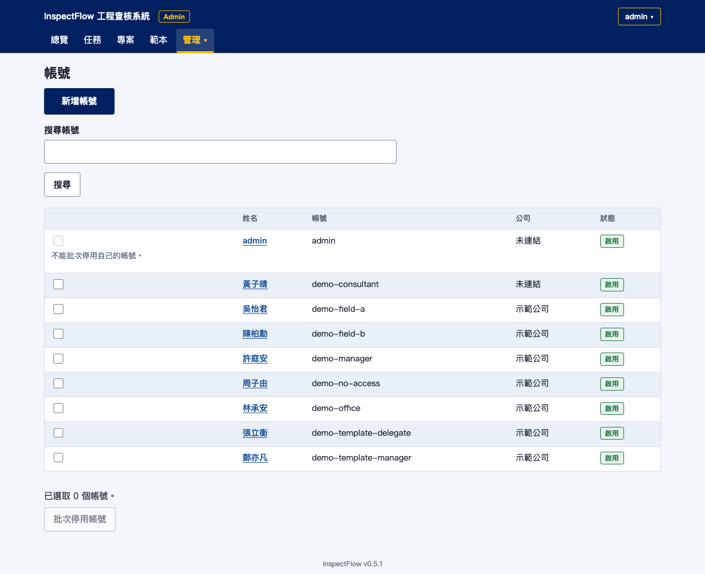
   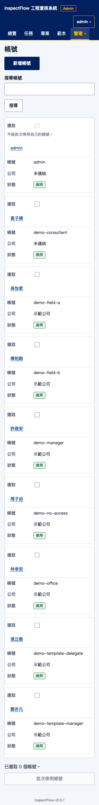
3. 畫面上方標示「步驟 1／4：帳號資料」。填寫「帳號名稱」「姓名」「電子郵件」（三項必填，例如帳號名稱 `demo-field-c`）；「公司」和「更多資料（選填）」可以先略過。按「下一步」。
   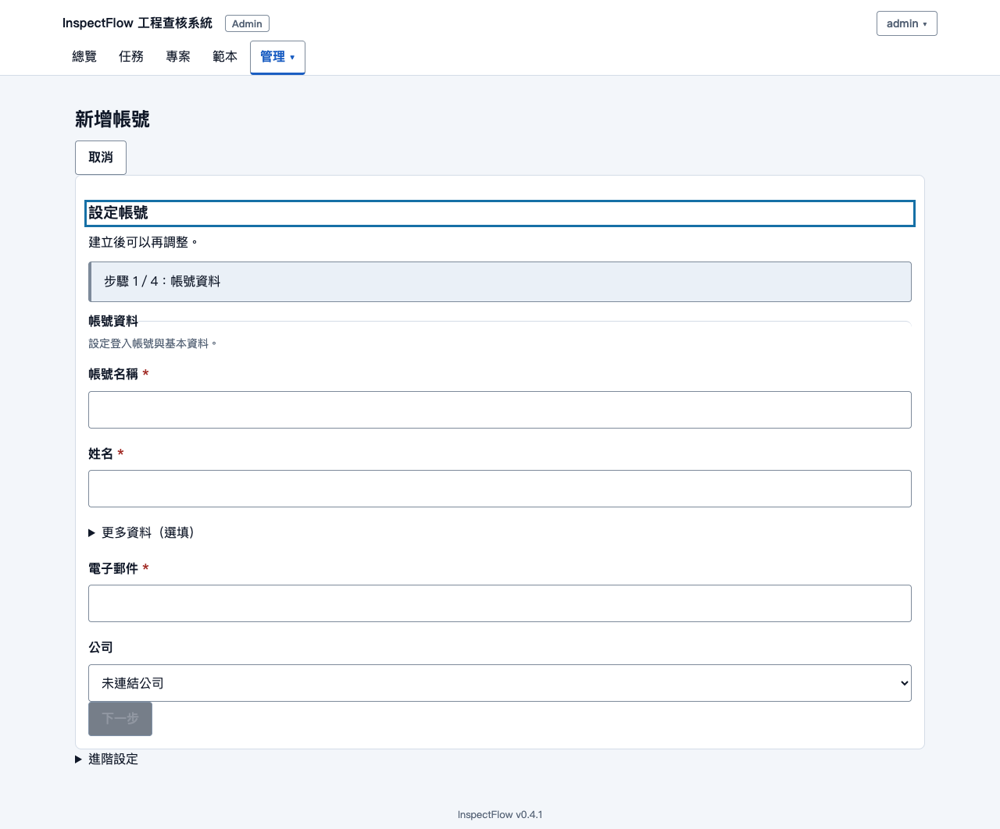
4. 在「選擇職務」選一個職務。現場工程師選「現場查核」，每個選項下方會列出「可做」的事。按「下一步」。
5. 在「加入專案（可略過）」選他要去的專案，例如「示範廠擴建機電工程」；還沒決定就留在「稍後再加入」。按「下一步」。
6. 在確認步驟核對「可以做」和「不能做」兩張清單，以及預設專案角色。確認無誤才按「建立帳號」。
7. 看到「帳號已建立」後，把畫面上的臨時密碼用安全管道交給本人。離開此畫面就無法再查看，本指南也不保存密碼截圖。
8. 按「查看這個帳號的能力」，確認結果；要連續建立下一位按「新增另一個帳號」，要回清單按「回清單」。
9. 第 5 步選了「稍後再加入」的話：到主導覽「專案」，在專案卡片按「成員」，於「加入成員」選好「成員」與「專案角色」，再按「加入成員」。
   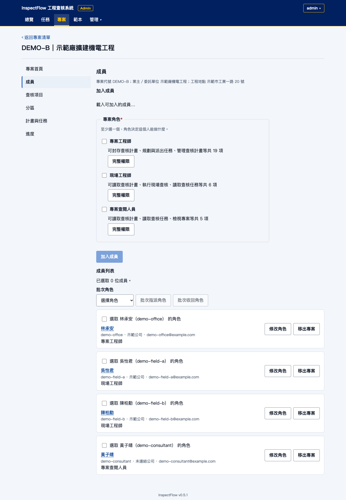

### 為什麼這樣設計

建立帳號分四步，每步只問一類事，管理者不用一次記住全部規則。建立前先列出「可以做」與「不能做」，讓管理者在按「建立帳號」之前就看到結果，不會事後才發現開錯人或多給權限。專案角色用預設值帶入，只給剛好夠用的角色，避免新人一進來就能改別人的東西。臨時密碼只顯示一次，可以降低密碼被留在畫面或截圖裡的風險。

## 2. 主管看進度：從總覽開啟任務清單

### 使用者故事

- 角色：主管（許庭安，`demo-manager`）。
- 情境：週會前想知道各專案的任務做到哪裡。
- 目標：只看進度，不碰現場資料，也不需要加入任何專案。

### 現場故事

週會前十分鐘，許庭安打開系統，想知道示範廠擴建機電工程還有幾件任務沒開始。他不是任何專案的成員，也不需要是：登入後只看到「總覽」，一眼看到每個專案的待開始、進行中、已完成。點進專案，任務清單逐筆列出狀態，他看到有兩筆還是草稿、尚未派出，會後直接去問內業。他看得到狀態、地點和建議指派的人，但照片和查核結果不在這裡，他也沒有任何能改資料的按鈕。

### 操作步驟

1. 以主管帳號登入。導覽只有「總覽」，登入後直接落在 `/overview`。
2. 在「專案進度」分頁的「專案進度總覽」，看各專案的「待開始」「進行中」「已完成」與「完成率」；專案多時，用「搜尋專案名稱」找。
   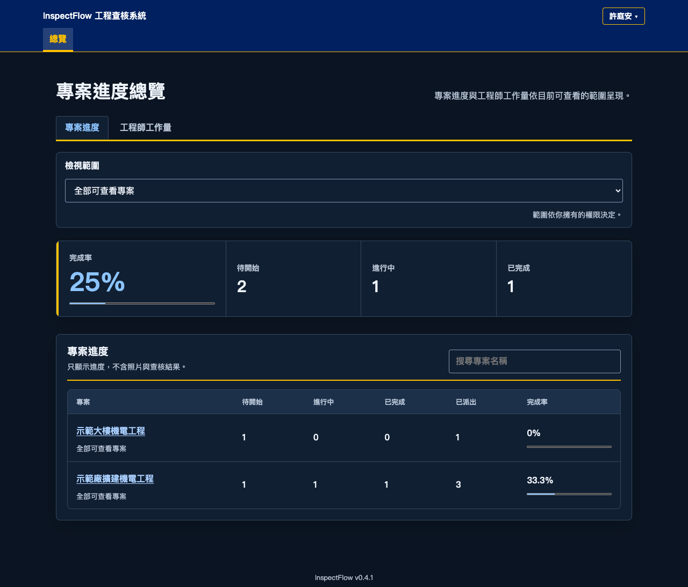
3. 按專案名稱，例如「示範廠擴建機電工程」，進入該專案的任務清單（`/overview/projects/:projectId/tasks`）。
4. 在「任務清單」確認右上標籤「全部進度・唯讀」；每一列有地點、狀態和「建議指派」（不顯示任務編號）。清單很長時按「載入更多任務」。
   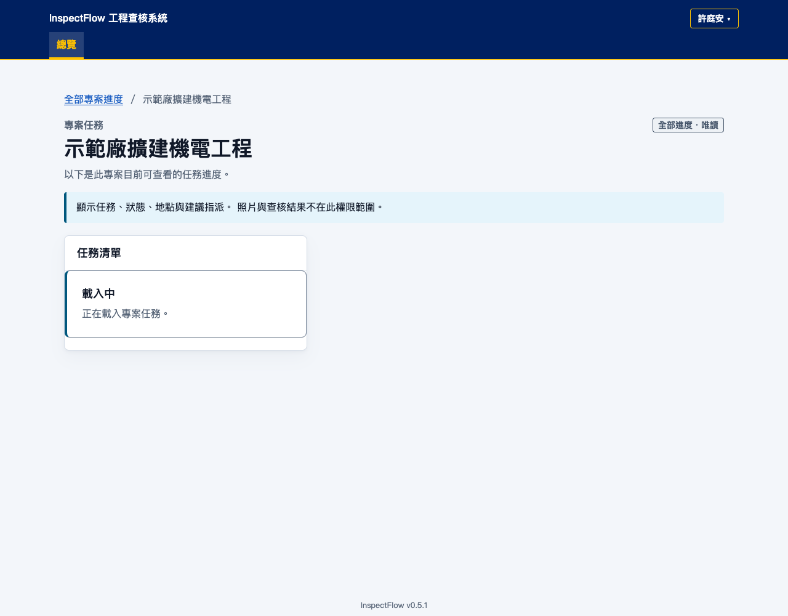
5. 按任一列，開啟「任務明細」，查看「狀態」「地點」「建議指派」。頁面註明「此頁不提供照片與查核結果」。
6. 要回到全部專案，按頁面上方的「全部專案進度」。
7. 注意：`/overview/projects/:projectId` 本身不是有效頁面，也不是總覽上的連結；一律從專案名稱進入任務清單。

### 為什麼這樣設計

主管要的是進度，不是現場證據，所以進度畫面只放任務、狀態、地點和建議指派，照片與查核結果不在權限範圍內。主管不必加入專案，就看得到全公司進度，也就不會因為「為了看一眼」而被多給專案角色。整條路都標示「唯讀」，沒有任何寫入按鈕，不會出現點了才被擋的假入口。

## 3. 外部協作：唯讀查看已加入的專案

### 使用者故事

- 角色：外部協作人員（黃子晴，`demo-consultant`）。
- 情境：顧問被加入「示範廠擴建機電工程」，只需要確認查核項目的內容。
- 目標：只看被加入的專案，並確認自己沒有改動資料的入口。

### 現場故事

顧問黃子晴第一次登入，導覽列只有「專案」一項。她打開後只看到被加入的示範廠擴建機電工程，卡片上寫著「我的角色：專案查閱人員」。她進到專案看查核項目，每一項旁邊只有「檢視」，沒有「從範本新增查核項目」，導覽也沒有「範本」。她確認：想看的都看得到，也不會不小心改到別人的東西。

### 操作步驟

1. 以外部協作帳號登入。導覽只有「專案」。
2. 在「我的專案」找到卡片，確認「我的角色」寫的是「專案查閱人員」。卡片只有「開啟專案」，沒有「套用範本」。
   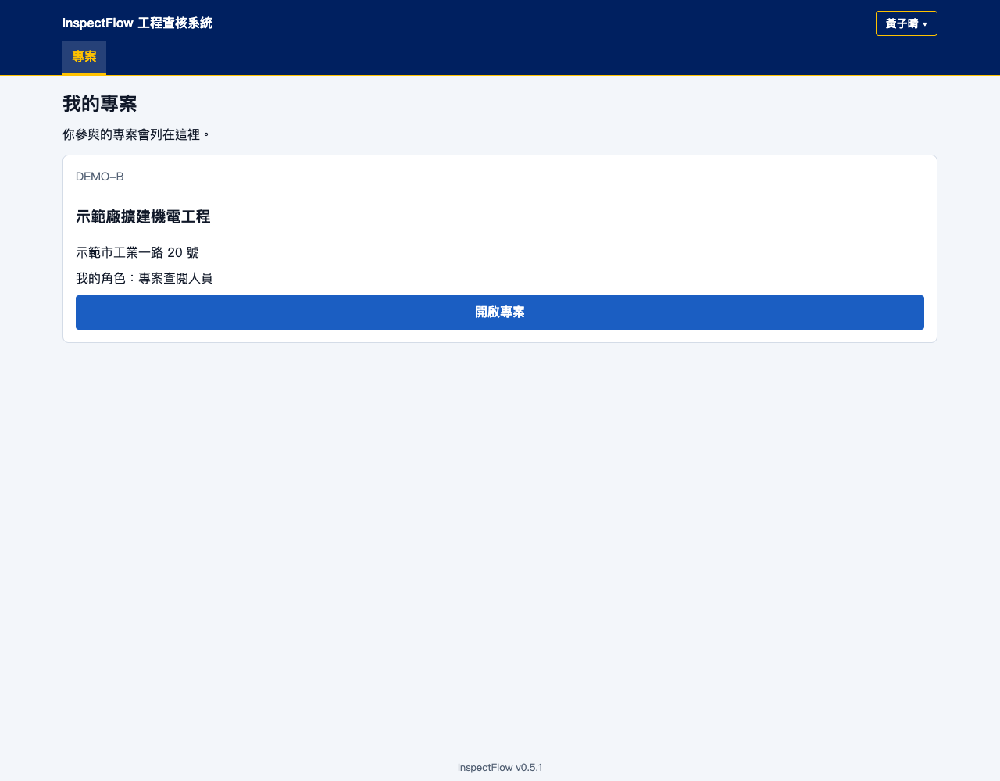
3. 按「開啟專案」。
4. 在左側選單選「查核項目」，進入「專案查核項目」。
5. 每個項目只有「檢視」可以按；頁面沒有「從範本新增查核項目」。外部協作不能套用範本，導覽也沒有「範本」。
   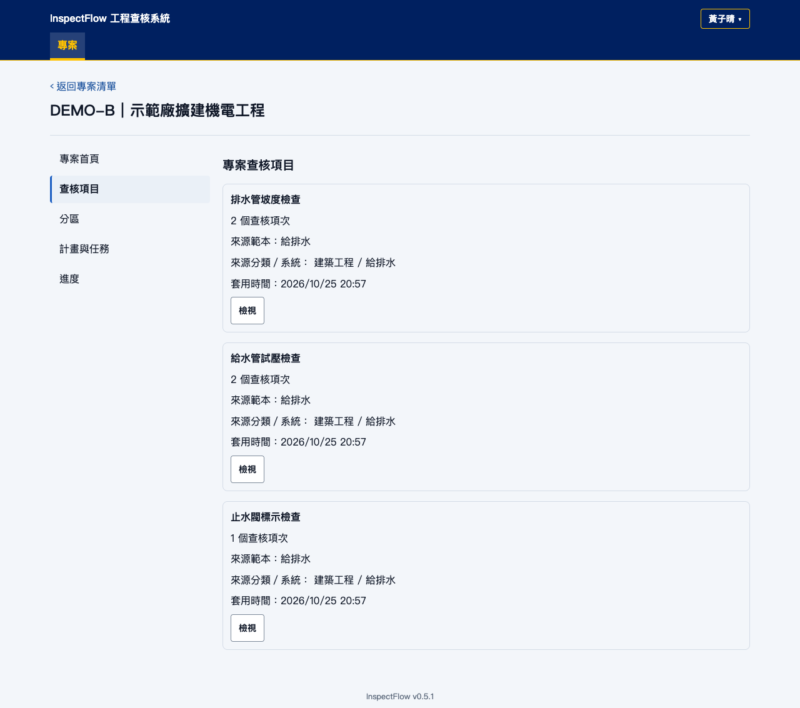
6. 需要更多專案或更高的專案角色時，請系統管理者到專案的「成員」頁調整。

### 為什麼這樣設計

外部人員只該看到自己被邀請的專案，所以清單只列已加入的專案。按鈕依專案角色決定要不要出現：沒有改動資格就不顯示「套用範本」與「從範本新增查核項目」，避免出現按了才被擋的假入口。外部協作不能套用範本，所以從登入後的第一個畫面起，對方就能看出自己只是來檢視，不用靠嘗試錯誤摸清邊界。

## 4. 查找存取原因：先比對專案角色

### 使用者故事

- 角色：系統管理者（`admin`）。
- 情境：現場工程師陳柏勳（`demo-field-b`）回報「我不能管理專案成員」。
- 目標：快速找出缺的是權限還是專案角色，並只補最小的一項。

### 現場故事

陳柏勳打電話說，他想把同事加進專案，卻找不到入口。系統管理者不用翻設定逐項猜：在他的帳號詳情有一塊「為什麼他不能做這件事？」，選好要檢查的操作和專案，按「檢查」。畫面回答：這個專案裡沒有可以管理成員的角色，並列出可補上的專案角色。管理者看過各角色能做的事，決定這個需求要不要滿足，而不是反射性地把權限最大的角色整包給出去。

### 操作步驟

1. 以系統管理者登入，在主導覽按「管理▾」，選「帳號」。
2. 按該帳號的姓名，例如「陳柏勳」，進入帳號詳情。
3. 在「能做什麼」先看「參與專案與角色」，確認他在哪些專案、各是什麼角色。
4. 到「為什麼他不能做這件事？」，在「要檢查的操作」選「管理專案成員」。
   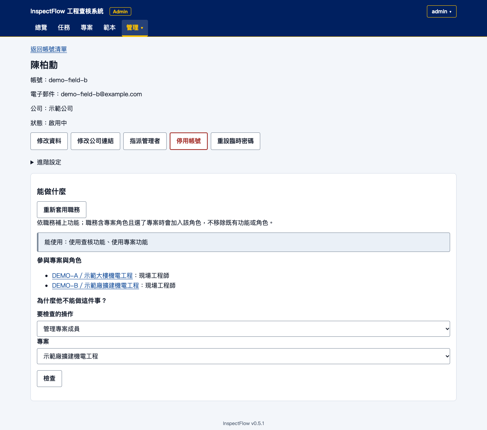
5. 在「專案」選「示範廠擴建機電工程」。
6. 按「檢查」。結果顯示「這個專案裡沒有可以管理成員的角色。」，並出現「可補上的專案角色」。
7. 逐一比較每個角色的說明，選取符合需求的那一個。
   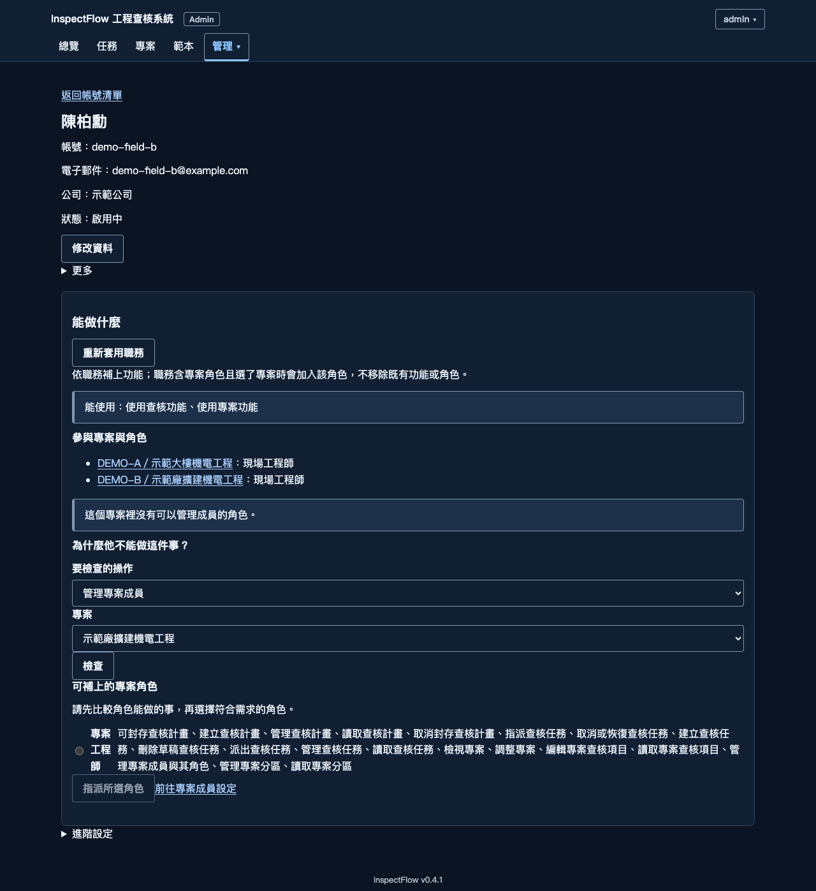
8. 確定要補，才按「指派所選角色」；想自己到成員頁處理，改按「前往專案成員設定」。本次走查沒有按下任何指派。
9. 若檢查結果寫的是「缺少…的權限」（例如建立專案、管理範本庫），先按「選取要開通的權限」，確認選好了再按「開通」。

### 為什麼這樣設計

「不能做」背後常見兩種原因：帳號沒有權限，或專案裡沒有適合的角色。把檢查做在帳號詳情，管理者不用兩邊猜。畫面不是一鍵授權，而是先列出角色內容再讓管理者選，只補需要的最小角色，不會多給權限。權限要先選好再按「開通」，避免一次點錯就改到不該改的人。

## 5. 委派範本權限工作

### 使用者故事

- 角色：被委派者（張立衡，`demo-template-delegate`）與系統管理者（`admin`）。
- 情境：系統管理者想把「使用範本」的開通工作交給張立衡，自己不再逐一處理。
- 目標：張立衡只能在被委派的範圍內為他人開通權限，不能碰其他事。

### 現場故事

新同事一多，開通範本功能的需求天天都有。系統管理者在張立衡的帳號設定裡勾選「可管理範本權限」，讓他幫忙。隔天張立衡登入，導覽只有「帳號」一項：他可以找到陳柏勳，勾選「使用範本功能」，按「開通」，畫面回報「已為陳柏勳開通使用範本功能。」。但他看不到系統管理者的帳號，也不能幫自己加權限，更沒有「範本」「公司」「角色」「紀錄」這些入口。

### 操作步驟

1. 系統管理者在「管理▾」選「帳號」，按「張立衡」進入詳情。
2. 展開「進階設定」，在「委派管理」勾選「可管理範本權限」。收回時取消勾選即可，收回委派不會移除對方已經開通的權限。
   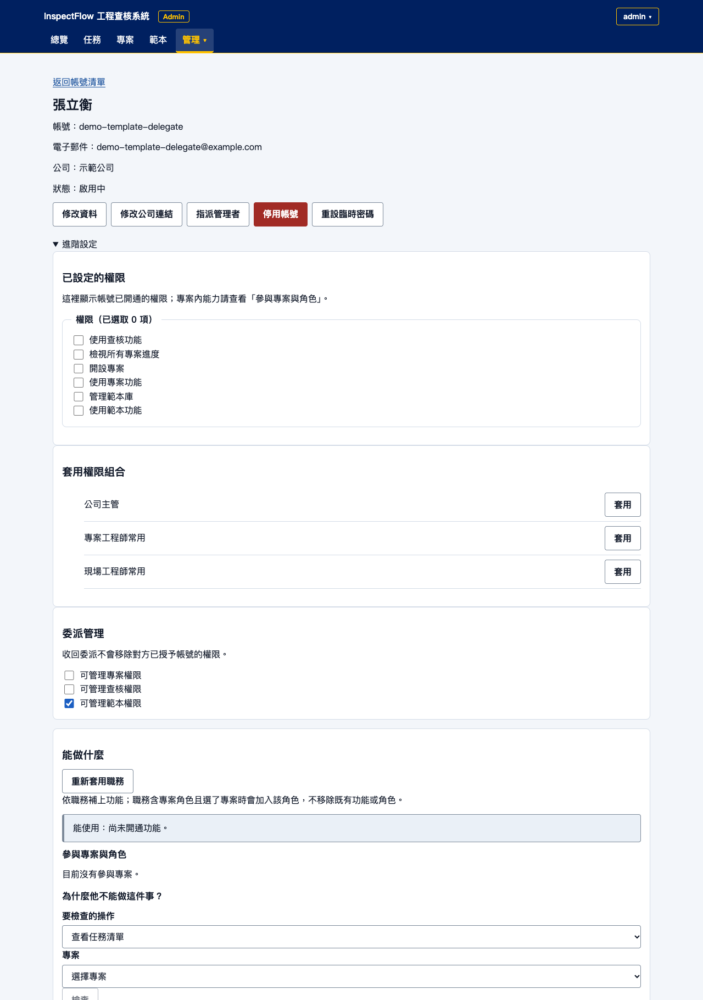
3. 張立衡登入，導覽只有「帳號」，進入「帳號」清單。
4. 在「搜尋帳號」輸入姓名後按「搜尋」，或直接按清單上的姓名，例如「陳柏勳」。清單裡不會出現系統管理者帳號。
   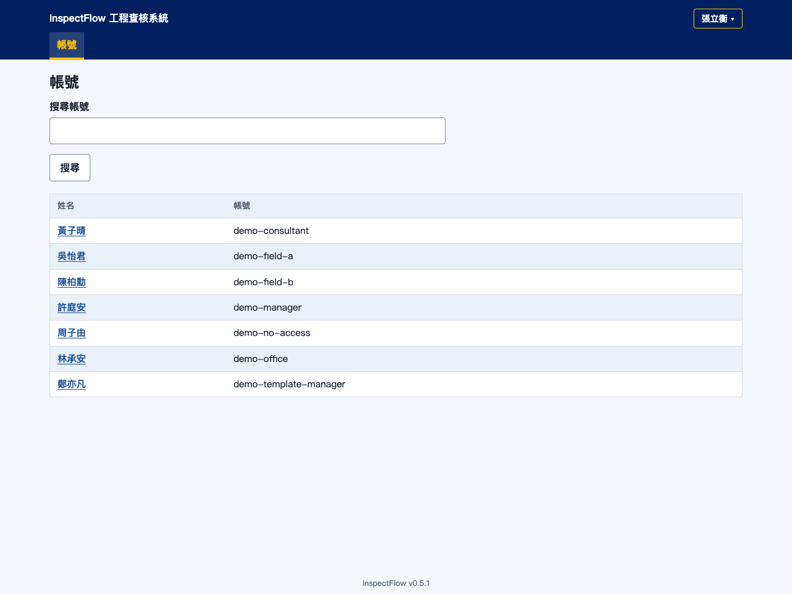
5. 在「權限」勾選「使用範本功能」。對象是外部協作人員時，不會出現「管理範本庫」。
6. 按「開通」，確認畫面出現「已為陳柏勳開通使用範本功能。」。
7. 要拿掉權限時，取消勾選後同樣按「開通」，畫面會先顯示「確認收回權限」與影響的專案成員人數；按「確認收回」才會送出，不收回按「取消」。

### 為什麼這樣設計

把重複的開通工作交給最靠近現場的人，系統管理者不再是瓶頸。委派者只看得到受委派範圍內的選項：不能查系統管理者的帳號、不能替自己開通，也不能轉交委派，所以委派不會變成提權的後門。選好再按「開通」、收回前先顯示影響，都是讓每次變更都有機會被看清楚再送出。

## 6. 離職停用：先核對對象與影響

### 使用者故事

- 角色：系統管理者（`admin`）。
- 情境：有同事離職，需要立刻讓他的帳號無法登入。
- 目標：停對人、不誤停別人，並確認狀態真的變了。

### 現場故事

人事通知周子由（`demo-no-access`）今天最後一天。系統管理者在帳號詳情選「停用帳號」，畫面不是馬上動手，而是先寫出「停用 demo-no-access 後，該帳號將無法登入。」，要她再按一次「確認」。她核對帳號名稱，確認是對的人，才按下去。回到詳情，狀態從「啟用中」變成「已停用」，一目了然。

### 操作步驟

1. 在主導覽按「管理▾」，選「帳號」。
2. 在「搜尋帳號」輸入姓名或帳號後按「搜尋」，再按目標的姓名，例如「周子由」，進入帳號詳情。
3. 先核對詳情上的「帳號」「電子郵件」「公司」，確認是要停用的人。
4. 展開「更多」，按「停用帳號」。
5. 在「操作確認」讀清楚帳號名稱與後果：「停用 demo-no-access 後，該帳號將無法登入。」
   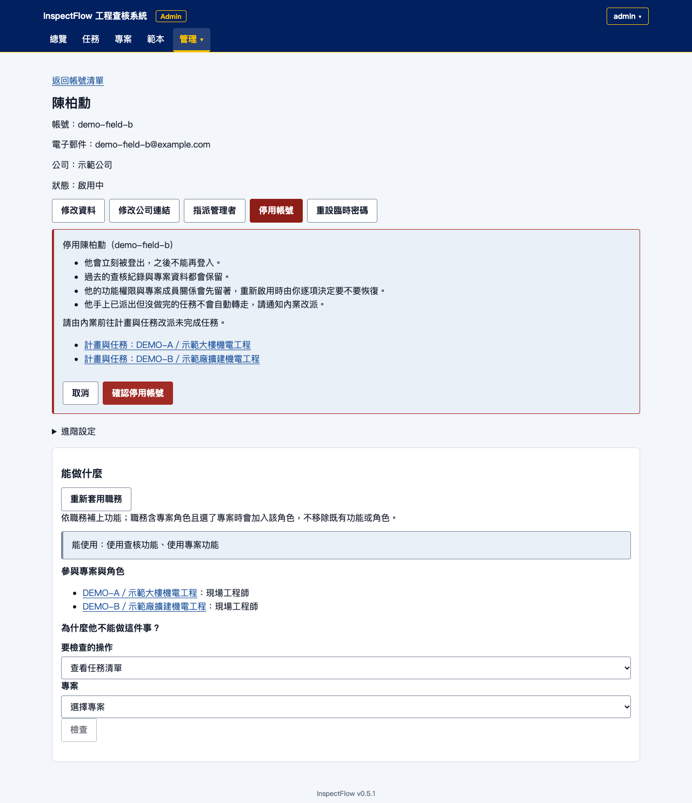
6. 確認無誤按「確認」；發現選錯人按「取消」，不會有任何變更。
7. 在詳情看「狀態：已停用」，確認已經生效。
   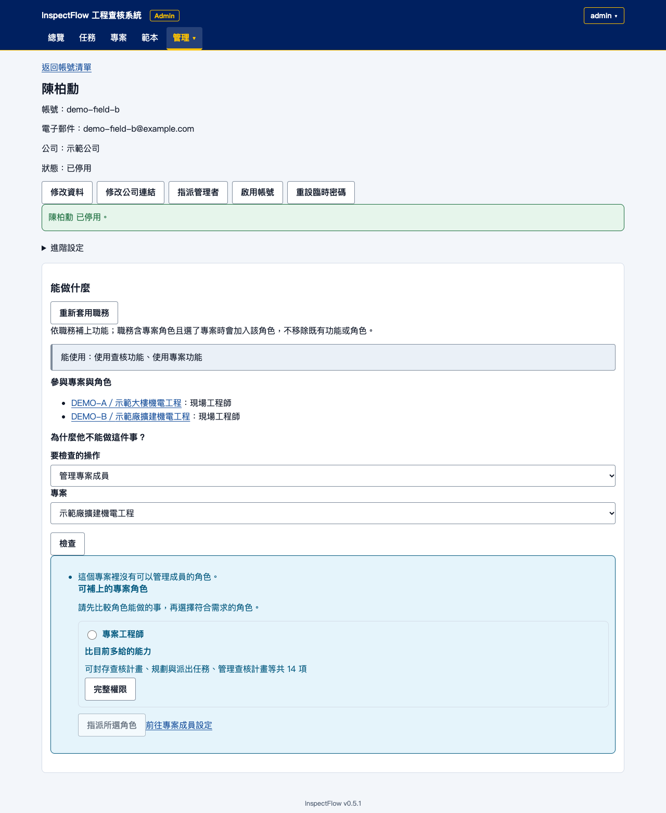
8. 若要恢復，同一處會變成「啟用帳號」，確認時可以選擇要恢復哪些權限。

隔離 demo 中以 `demo-no-access` 實際完成停用，詳情顯示「已停用」；為免影響後續示範，截圖後已重新啟用，回讀顯示「啟用中」。

### 為什麼這樣設計

停用會立刻影響一個人的工作，所以把按鈕放在「更多」裡，並且一定要再按一次「確認」。確認畫面把帳號名稱與後果寫出來，選錯人的時候，最後一眼還有機會發現。停用之後狀態馬上寫在詳情頁，管理者不必另外再登入驗證。需要恢復時也有明確的「啟用帳號」入口。

## 7. 修改專案角色前查看持有人數

### 使用者故事

- 角色：系統管理者（`admin`）。
- 情境：想替「現場工程師」角色調整一項權限。
- 目標：先知道有多少專案、多少人會被影響，再決定要不要改。

### 現場故事

現場回報「現場工程師」少了一項功能，系統管理者想直接調整。他先到「角色」頁看表格：專案工程師有 1 個帳號，現場工程師有 2 個帳號。他知道這次修改會同時影響兩個人。他按下「修改」並儲存後，確認畫面再次寫出「會影響幾個專案中的幾個帳號」，他覺得範圍可接受，才按「確認修改角色」。

### 操作步驟

1. 在主導覽按「管理▾」，選「角色」（網址 `/roles`），標題是「專案角色」。
2. 在表格的「持有人數」確認每個角色有幾個帳號；示範畫面中「專案工程師」有 1 個帳號、「現場工程師」有 2 個帳號。
   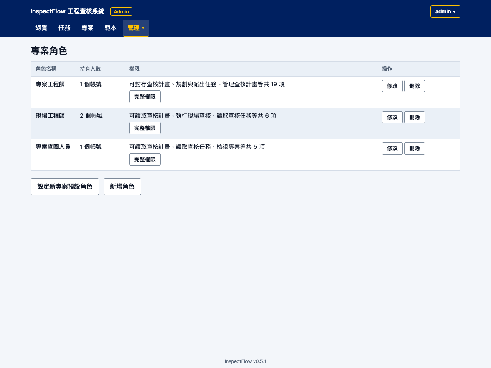
3. 按該角色的「完整權限」，確認它目前包含哪些項目。
4. 想知道具體是哪些人：主導覽按「專案」，在專案卡片按「成員」，成員列表會列出每個人的角色。
   
5. 回到「角色」，按要改的角色那一列的「修改」，調整「權限」的勾選，再按「儲存角色」。
6. 在確認畫面讀「此變更會影響 N 個專案中的 M 個帳號，儲存後立即生效。」無誤按「確認修改角色」；改變主意按「取消」。
7. 角色用不到了才按「刪除」，確認畫面會說明成員身上的這個角色會一併移除、無法復原，按「確認刪除角色」才送出。有持有人時，請先確認受影響的成員再刪。

### 為什麼這樣設計

角色是大家共用的，改一次就影響所有持有人，所以先把「持有人數」放在表格上。按下儲存後，確認畫面會用最新數字再算一次影響範圍，避免列表上的舊數字誤導。修改生效是即時的，所以必須多一道「確認修改角色」，讓管理者在動手前再看一次影響範圍。

## 九個示範帳號的實際入口

以下各帳號均在隔離 demo 中實際登入。截圖呈現各自的可用入口；密碼不納入指南。

| 帳號 | 登入後入口 | 畫面 |
|---|---|---|
| `admin` | 總覽；「管理」含帳號、公司、角色、紀錄 | [帳號清單](images/account-list-admin.png) |
| `demo-manager` | 總覽 | [進度總覽](images/manager-overview.png) |
| `demo-office` | 專案 | [專案清單](images/office-project-list.png) |
| `demo-field-a` | 任務、專案 | [任務清單](images/field-a-tasks.png) |
| `demo-field-b` | 任務、專案 | [任務清單](images/field-b-tasks.png) |
| `demo-template-manager` | 範本 | [範本庫](images/template-manager-library.png) |
| `demo-template-delegate` | 帳號 | [帳號清單](images/delegate-account-list.png) |
| `demo-consultant` | 專案 | [專案清單](images/consultant-project-list.png) |
| `demo-no-access` | 個人設定；顯示尚未開通功能的說明 | [個人設定](images/no-access-settings.png) |

主導覽順序為「總覽、任務、專案、範本、管理」；只顯示帳號可使用的項目。「範本」只對範本管理者或系統管理者顯示。委派者只有「帳號」時，直接顯示「帳號」入口。
